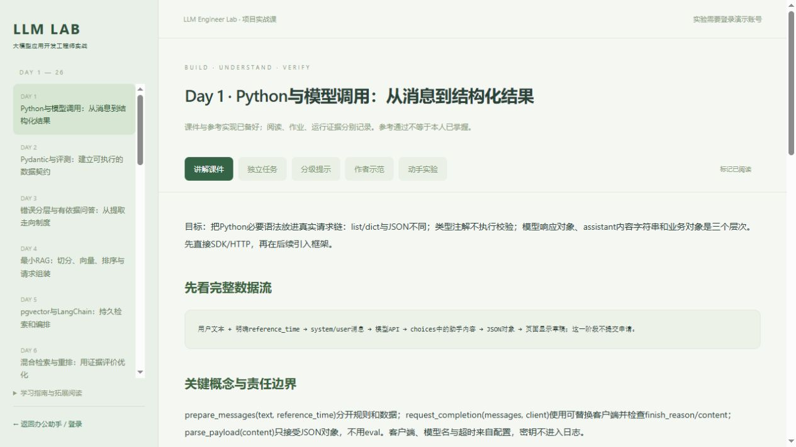

# LLM Engineer Lab

**Python 大模型应用工程实战课：从后端经验出发，独立交付、评测和维护 RAG 与 Agent 应用。**

[](https://github.com/AlexXuz/llm-engineer-lab/actions/workflows/course.yml)
[](LICENSE)
[](https://www.python.org/)

26个学习单元，一套本地网页课堂。前半程用办公案例练模型、RAG和业务边界；后半程独立开发客服调查Agent，再迁移到研发调查或资料研究。适合有Java等后端经验、希望转向Python大模型应用开发的工程师；已有权限、事务和排障经验可直接迁移，不要求保留Java技术栈。



## 从哪里开始

- **新学员使用 `main`**：练习骨架与学习进度从未学习状态开始，完整示范单独呈现。
- **`alexstudy` 是作者的个人学习分支**：保留已有实现、阶段记录与进度，可事后对照，不要当作自己的默认作业。
- 课程在网页阅读；作业 `.py` 文件已经创建，在IDE里直接写，保存后回到页面检查。
- 不以看完、参考实现通过或复制代码计完成。每课有独立任务、需求变体、失败恢复与证据要求；Day19、24、26是阶段验收门。

## 完整启动（推荐：本机 Python + Docker 数据库）

**下面的步骤必须依次完成。只运行 `scripts.open_course` 会打开网页，不会启动 Docker 或数据库；登录、查看余额和网页实验仍需要 PostgreSQL。** 本机运行 Python 方便在 IDE 修改作业，Docker 负责运行 PostgreSQL + pgvector。

### 1. 安装并启动 Docker

准备 Python 3.11、Git 和 Docker。Windows/macOS 使用 [Docker Desktop](https://docs.docker.com/desktop/)，Windows 安装步骤见[官方说明](https://docs.docker.com/desktop/setup/install/windows-install/)；Linux 可使用 Docker Engine + Compose 插件。本项目使用 **Linux 容器**。

打开 Docker Desktop，等待显示 **Engine running**，然后在终端确认：

```bash
docker info
docker compose version
```

两条都成功后再继续。`docker --version` 只能证明命令行已安装，不能证明引擎已启动；出现 `dockerDesktopLinuxEngine` / `Cannot connect to the Docker daemon` 时先启动引擎。首次安装后若提示 WSL/重启，按 Docker 安装向导完成后重试。

### 2. 克隆项目并安装 Python 依赖

**Windows / PowerShell**

```powershell
git clone https://github.com/AlexXuz/llm-engineer-lab.git
cd llm-engineer-lab
python -m venv .venv
.\.venv\Scripts\python.exe -m pip install -c requirements/course.lock.txt -r requirements/course-runtime.txt
```

**macOS / Linux**

```bash
git clone https://github.com/AlexXuz/llm-engineer-lab.git
cd llm-engineer-lab
python3 -m venv .venv
.venv/bin/python -m pip install -c requirements/course.lock.txt -r requirements/course-runtime.txt
```

### 3. 创建本机配置

以下命令在**项目根目录**执行，仅创建缺失文件，已有配置不会覆盖。

**Windows / PowerShell**

```powershell
if (-not (Test-Path .env)) { Copy-Item .env.example .env }
if (-not (Test-Path .env.pgvector)) { Copy-Item .env.pgvector.example .env.pgvector }
notepad .env.pgvector
```

**macOS / Linux**

```bash
test -f .env || cp .env.example .env
test -f .env.pgvector || cp .env.pgvector.example .env.pgvector
# 使用编辑器打开 .env.pgvector。
```

把 `.env.pgvector` 中 `PGPASSWORD=replace-with-a-local-password` 改成自己的本地数据库密码。首次运行保持其余默认项：`PGHOST=127.0.0.1`、`PGPORT=55432`、`PGDATABASE=leave_assistant_lab`、`PGUSER=leave_lab`。Compose 建库与 Python 连接读取同一个文件，不需要再建一个不同密码的数据库。

`.env` 中的 `LLM_API_KEY`、`LLM_BASE_URL`、`LLM_MODEL` 用于真实模型请求。**登录和固定参考检查可先留空 Key；要在办公助手里生成自然语言请假草稿，必须配置有效的模型服务。** 两个环境文件都只留本机，不提交 Git。

### 4. 先启动数据库，再启动网页

```bash
docker compose --env-file .env.pgvector -f deployment/compose.pgvector.yaml up -d --wait
docker compose --env-file .env.pgvector -f deployment/compose.pgvector.yaml ps
```

首次执行会下载 `pgvector/pgvector:0.8.7-pg17` 镜像，等待 `postgres` 显示 **healthy**。此配置将数据库绑定到本机 `55432`，数据库内部端口是 `5432`；不要将 Python 的 `PGPORT` 改成 `5432`。

**Windows / PowerShell**

```powershell
.\.venv\Scripts\python.exe -m scripts.open_course
```

**macOS / Linux**

```bash
.venv/bin/python -m scripts.open_course
```

课件入口：**http://127.0.0.1:8012/course**；办公助手/登录入口：**http://127.0.0.1:8012/**。Windows 也可在数据库启动后双击 `start-course.cmd`。登录后会自动初始化教学表与账号，无需先运行 RAG 建索引脚本。

### 5. 登录并确认可用

| 账号 | 部门 | 初始可用年假 |
|---|---|---:|
| zhangsan | 研发 | 9天 |
| lisi | 财务 | 3天 |
| wangwu | 运营 | 0天 |
| zhaoliu | 产品 | 15天 |

教学密码均为 `demo123`，数据采用固定2026年度的模拟案例。刷新、重登和重启不重置额度；生产身份、真实HR、实际审批引擎需单独集成。

先登录 `zhangsan`，确认页面能读到年假余额；新数据库初始为 9 天。在课程页选择“作者示范/检查参考函数”可做固定检查。已配置模型后，可输入“2026年11月2日至5日请四天年假，处理家事”体验生成、确认与提交；提交会真实预占教学额度，不是重置按钮。

| 想做什么 | 需要什么 |
|---|---|
| 只读课件、在 IDE 写代码 | Python 运行依赖；可跳过 Docker 和配置步骤，直接运行 `scripts.open_course` |
| 登录、余额、网页热身检查、固定参考实验 | Docker 引擎运行、数据库 healthy、正确的 `.env.pgvector` |
| 自然语言草稿、真实 Agent/模型回答 | 上述环境 + `.env` 中有效的模型配置；本人 Agent 入口仍需按课程实现 |
| 向量检索、OCR、CPU 训练 | 按对应课程另装依赖/模型并准备索引，不是数据库启动后自动具备 |

### 以后每天怎么启动

先打开 Docker Desktop，再在项目根目录重跑第 4 步。无需重新克隆、安装依赖或复制配置。网页已运行时启动器会复用现有服务；余额和历史保存在数据库卷中。

需要“Web + 数据库全部用 Docker”的方式，或遇到登录失败、端口占用、密码不匹配，请看[完整部署与排障](docs/deployment.md)。全容器方式使用 **8013**，与推荐开发方式的 **8012** 不同；选一种方式使用。

## 你会完成什么

| 单元 | 能力与交付 |
|---|---|
| [Day1–3](course/lessons/day01.md) | Python必要迁移、SDK/HTTP模型调用、Pydantic、评测、错误分层、有依据问答 |
| [Day4–6](course/lessons/day04.md) | 切分、Embedding、最小RAG、pgvector、LangChain、混合检索与重排对照 |
| [Day7](course/lessons/day07.md) | 文档快照、更新/删除、版本、事务和检索前权限 |
| [Day8–9](course/lessons/day08.md) | PDF/Word与表格、来源定位、引用、OCR质量和审核边界 |
| [Day10–11](course/lessons/day10.md) | Tool Calling、实时业务查询、草稿预检、明确确认、事务和幂等提交 |
| [Day12–15](course/lessons/day12.md) | LangGraph暂停恢复、上下文/记忆、MCP、按需加载Skill |
| [Day16–19](course/lessons/day16.md) | Python服务工程、异步工具/SSE/取消、追踪与成本、独立客服调查Agent硬验收 |
| [Day20–21](course/lessons/day20.md) | Agent逐任务重复评测与单变量优化、数据划分、SFT/LoRA机制与边界 |
| [Day22–23](course/lessons/day22.md) | 受控ChatBI、SQL AST/数据库权限、数值溯源和图表 |
| [Day24–26](course/lessons/day24.md) | 跨领域Agent与持久恢复、Python岗位作品集、独立部署/回滚与产品交付 |

Day19必须本人实现观察驱动的工具循环；Day24更换数据源、工具和成功标准；Day26交付自己的Python服务与真实评测/恢复记录。已有OA任务和学习代码保留，不能替代新版主任务。

学习单元不等于必须一天学完。主线优先完成可核验交付，选修按目标岗位选择，不以框架数量或刷完课件作为能力证明。

## 学习方式

1. 阅读讲解，先用固定样例理解输入、输出和调用链。
2. 在IDE完成热身，再独立设计并实现本课任务；原有脚手架负责通用基础设施。
3. 卡住时看分级提示，记录自己的尝试之后再展开完整作者示范。
4. 从自己的页面/API/脚本运行正常、变体与失败恢复，留下本人证据。
5. 关键项复核通过后再更新学习进度。公开变体不是秘密留出题，已练过的需求应另换一题验证迁移。

[证据与验收规则](course/EVIDENCE_PROTOCOL.md) · [学习进度](course/LEARNER_PROGRESS.md) · [选修路线](course/OPTIONAL_PATHS.md) · [求职补强](course/portfolio/APPLICATION_READINESS.md)

## 项目结构

```text
app/                 业务服务、课程网站与教学基础设施
  course/examples/   明确标注的完整参考实现
  web/               网页课堂与办公助手界面
course/
  lessons/           Day1–26讲解，网页直接读取
  tasks/             独立任务、变体、失败与验收标准
  projects/          已创建的独立任务Python文件与HTTP脚手架
  assignments/       后半程热身；基础练习入口见每课映射
  solutions/         分级提示与验收讨论
  submissions/       未完成的本人证据模板
  portfolio/         岗位映射、项目证据与演示模板
docs/                部署、架构、贡献和安全说明
deployment/          Dockerfile与Compose
requirements/        按运行/实验模块拆分的固定依赖
infra/               教学SQL与约束
data/                明确标注的合成资料和评测样例
scripts/             启动、实验、维护与回归入口
tests/               自动化测试
```

默认项目提供可运行基础示范、客服工具沙箱和评测器；独立Agent循环与应用由学员完成。作者示范通过不代表本人作业通过。架构和分支职责见 [架构说明](docs/architecture.md)。

## Agent练习入口

先读[任务书](course/tasks/single_agent_delivery.md)和[评测指南](course/reading/agent_evaluation_lab.md)，在`course/projects/support_agent_runtime.py`实现自己的模型适配与循环。

```powershell
.\.venv\Scripts\python.exe -m unittest tests.test_agent_evaluation -v
.\.venv\Scripts\python.exe -m scripts.evaluate_agent --mode offline --repeats 3 --output reports/learner/agent-offline.json
```

第一条只自检基础设施；第二条在学员尚未实现时应失败。offline是运行标签，适配器须自行使用固定模型替身；不会自动替你接模型或证明真实模型执行。工具检查通过后仍需人工核对任务语义。

## 验证与边界

- 课程结构、参考契约、真实教学SQL、检查点、MCP/Skill、SSE和HTTP回归分开验证；CI不使用真实模型Key。
- CPU LoRA是随机微型模型的训练机制实验，不冒称业务大模型微调效果。
- 本机Docker不冒称云生产、SSO或多实例高可用；ChatBI限定少量模拟表与受控查询。
- 数据、接口和权限是教学范围。真实云部署、提示注入与成本延迟评估、失败恢复演示按任务逐项补证。

维护检查：

```bash
python -m scripts.check_public_project
python -m scripts.check_course_revision
python -m scripts.check_course_package
python -m scripts.check_course_http
```

后面两项需要教学PostgreSQL。具体实际执行范围见网页验证说明，不能将作者报告复制成本人结果。

## 参与与许可

欢迎改进解释、任务、失败案例、可复现性和基础设施；提交PR前请阅读 [贡献指南](docs/contributing.md) 和 [安全说明](docs/security.md)。新功能应带验证依据，不将个人学习答案直接合并进默认骨架。

代码和原创课程材料采用 [MIT License](LICENSE)。第三方依赖、模型与字体遵循各自许可证；仓库不包含API Key、虚拟环境、模型权重或真实员工数据。
