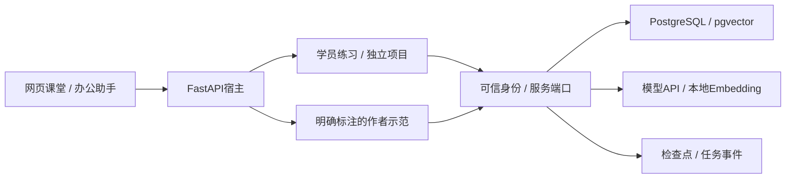

# 架构与分支职责

课程网站读取course/manifest.json、讲解、任务与提示；阅读不需要模型Key或数据库。业务演示才连接数据库、模型或本地Embedding。前半程OA案例提供可控的RAG/事务基础；后半程转向本人Python服务、客服调查Agent与跨领域恢复交付。

新版Agent实验由三部分组成：course/projects中的学员适配器与循环、app/course/agent_lab.py中的合成工具宿主、agent_evaluation.py和scripts/evaluate_agent.py中的评测记录。工具宿主提供API契约和可控故障，不是任意代码安全沙箱；评测器不提供Agent答案，也不自动认证任务语义或真实模型调用。

Day16/17/19/20/24有新的独立项目入口；旧学习源码保留。Day26用agent_product_delivery.md整理本人产品证据。课程网页的旧余额Agent、报告SSE和SQLite图是基础示范，不能代替新版项目。学员需要自己实现模型适配、独立MCP/HTTP工具集成、持久任务和部署。

## main与alexstudy

- main是新学员初始骨架：核心练习待实现、所有本人证据待填、阅读标记不代表完成。
- alexstudy保留已有个人实现和历史阶段验收，默认继续Day12；它可以包含个人运行报告，不能冒认新学员结果。
- 作者示范位于app/course/examples。网站演示明确使用示范，热身检查按模式调用学员或参考实现。
- 默认分支初始化通过独立工作副本制作，不能在个人目录清空答案或重置本机数据库。

## 信任边界

模型、检索文本、工具返回与历史摘要是待校验输入。身份从宿主会话取得，确认从服务端版本记录读取；提交和额度以SQL事务为事实来源。检查点保存编排位置，不替代业务账本；哈希与JSON不能自动证明语义或独立掌握。

公开演示账号用于回环地址上的教学。上云时先补认证/访问控制、密钥管理、日志和恢复；不将课程源码阅读入口和默认密码直接开放为生产服务。
